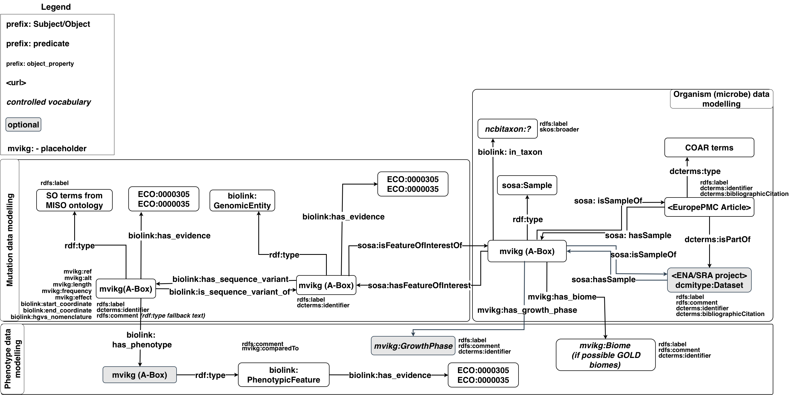

# nanopubWork

This repo presents the intial steps for implementing nanopublications to 
a knowledge graph documenting microbial variants. 
A researcher can submit new variant and phenotype data through a spreadsheet. 
Once a human reviewer approves the submission, it is turned 
into the same kind of record the knowledge graph already uses for data curated using LLMs.

## Schema




## Nanopublication

- **Assertion** — the claim itself (strain, gene, variant, result).
- **Provenance** — who submitted it, who approved it, when.
- **Pubinfo** — when this record was built, and whether it's signed yet.


## Pipeline

1. Researcher fills in a spreadsheet: strain, gene, variant, result.
2. Any ID numbers given (NCBI, UniProt) get checked against the existing 
   databases.
3. The data is turned into a nanopublication (RDF triples) guided by the schema.
4. The submission goes into a review queue. 
5. TBI - A human reviewer should ideally approve/reject. Rejected submissions go back to the
   researcher to fix and resubmit.
6. TBI - Approved submissions get built into a draft record, with a note on
   who approved it and when.
7. TBI — signing, publishing, and adding to the main knowledge
graph — aren't built yet. Thisrequires a signing identity for this project on nanodash.


## Rough repo layout

| File or folder | Purpose |
|---|---|
| `templates/mvikg_submission_template.xlsx` | Example tempelate spreadsheet researchers fill in |
| `scripts/make_nanopub_submission_template.py` | Regenerates that blank spreadsheet |
| `csvw/` | Mapping rules from spreadsheet to RDF, plus a README on their limits |
| `src/common/utils_id_validation.py` | Validates submitted NCBI/UniProt IDs |
| `scripts/render_submission_rdf.py` | Validates, builds RDF, queues for review |
| `scripts/review_queue.py` | List, approve, reject submissions |
| `scripts/build_nanopub.py` | Builds the unsigned draft record for an approved submission |


## Building nanopub from xlsx data

```
pipenv run python3 -m scripts.render_submission_rdf <spreadsheet path>
pipenv run python3 -m scripts.review_queue approve <submission id> --reviewer <name>
pipenv run python3 -m scripts.build_nanopub <submission id> <rdf path> <output folder>
```

## Known gaps

- Mismatched wording for the same strain/gene across tabs may break
  the link between them. For now, wrong ID numbers are flagged.
- Genetic notation (ideally HGVS formatted) and genomic coordinates 
  for a variant aren't cross-checked against each other.
- Signing and publishing is a manual step for later, once a signing
  identity exists for this project.
